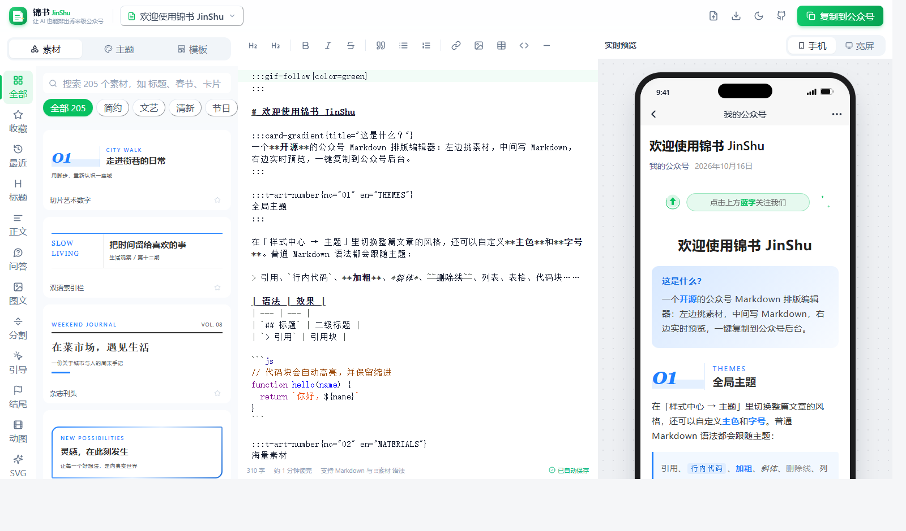
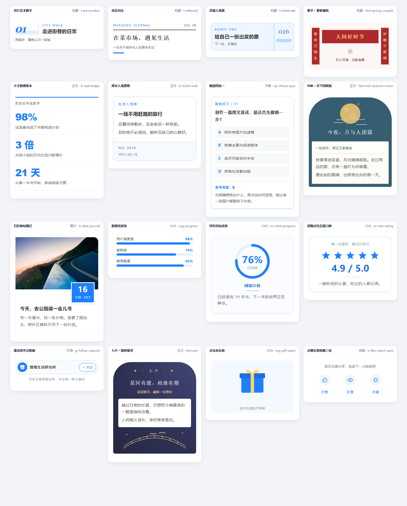
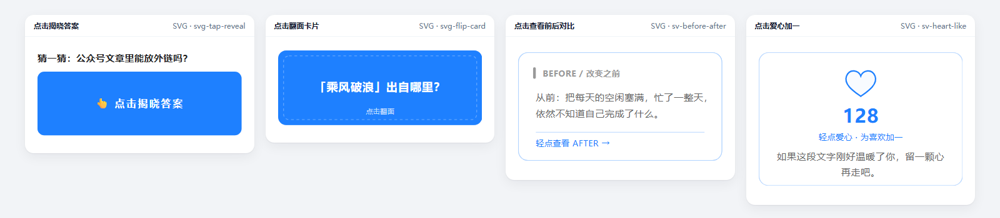

<div align="center">


# 锦书 JinShu

**让 AI 也能排出秀米级公众号**

开源的公众号排版编辑器：用 Markdown 写作，就能用上 **200+ 素材**、**GIF 动图**和**可点击的 SVG 互动**。<br/>
素材语法简单到 AI 一学就会，让 Claude / ChatGPT 直接写出排好版的文章。

[](LICENSE)
[](https://reclyoirl-dot.github.io/jinshu/gallery.html)
[](docs/CONTRIBUTING.md)
[](https://github.com/reclyoirl-dot/jinshu)

[**在线使用**](https://reclyoirl-dot.github.io/jinshu/) · [**素材总览**](https://reclyoirl-dot.github.io/jinshu/gallery.html) · [素材手册](docs/MATERIALS.md) · [AI 技能包](skills/) · [参与贡献](docs/CONTRIBUTING.md)

</div>



## ✨ 为什么是锦书

市面上的 Markdown 公众号编辑器大多只有「整篇主题」；秀米、135 素材很多，但不能用 Markdown 写。锦书想把两边的好处放在一起：

- **📝 Markdown 写作，秀米级素材**：标题、卡片、问答、图文、分割线、关注引导、节日素材，点一下就插入，排版跟着主题色自动变化。
- **🎞️ 动图 + 🖱️ SVG 点击互动**：37 款 GIF 动图（大多有 5 种配色），30 款 SVG 动效。「点击揭晓答案」「点击拆礼物」「点击翻面」这类互动，**粘贴到公众号后依然可以点**。
- **🤖 对 AI 友好**：素材就是一行 `:::素材名{参数}`，配合[素材手册](docs/MATERIALS.md)和 [AI 技能包](skills/)，让 AI 写文章时顺手把排版也做了。
- **🧩 素材即代码**：每个素材都是一个小文件，提一个 PR 就能贡献，测试会自动检查公众号兼容性。
- **🔒 纯前端、可自部署**：文章只存在你的浏览器里，MIT 协议，部署到 GitHub Pages 就能用。

## 🎨 素材一览

<p align="center"></p>

> 以上都是真实渲染效果。全部 205 个素材见 👉 [素材总览页](https://reclyoirl-dot.github.io/jinshu/gallery.html)

### 动图

<table>
  <tr>
    <td align="center"><br/>点击蓝字关注</td>
    <td align="center"><br/>分享收藏点赞在看</td>
    <td align="center"><br/>喇叭最新公告</td>
  </tr>
  <tr>
    <td align="center"><br/>新春灯笼</td>
    <td align="center"><br/>新年烟花</td>
    <td align="center"><br/>中秋明月</td>
  </tr>
  <tr>
    <td align="center"><br/>红包来啦</td>
    <td align="center"><br/>倒计时</td>
    <td align="center"><br/>生日愿望</td>
  </tr>
</table>

### SVG 点击互动

<p align="center"></p>

点一下封面揭晓答案、卡片翻面、查看前后对比、爱心 +1……用的都是公众号支持的 SVG 原生动画，不依赖脚本。

## 🤖 让 AI 帮你排版

锦书的素材语法是纯文本，AI 很容易学会：

```markdown
:::t-art-number{no="01" en="CITY WALK"}
走进街巷的日常
:::

:::svg-tap-reveal
猜一猜：公众号文章里能放外链吗？

不能。除了公众号文章链接，正文里的外链都无法点击，锦书会自动把它们转成文末的参考链接。
:::

:::gif-actions{color=red}
:::
```

- 把 [素材手册](docs/MATERIALS.md) 发给 AI，或者在 Claude Code / Codex 里加载 [AI 技能包](skills/)。
- 让它「用锦书素材语法写一篇关于 XX 的公众号文章」，粘贴进编辑器，就能看到排好版的效果。

## 🚀 快速开始

**在线使用**：打开 [reclyoirl-dot.github.io/jinshu](https://reclyoirl-dot.github.io/jinshu/)，写完点「复制到公众号」，到公众号后台 `Ctrl + V` 粘贴即可。

**本地运行**（需要 Node.js 20+ 与 pnpm）：

```bash
git clone https://github.com/reclyoirl-dot/jinshu.git
cd jinshu
pnpm install
pnpm dev
```

其他命令：

```bash
pnpm test      # 渲染管线 + 全部主题、素材、模板的公众号兼容性测试
pnpm build     # 构建静态站点到 dist/
pnpm gifs      # 重新生成动图素材（见贡献指南）
```

## ✍️ 素材语法

```markdown
:::素材名{参数="值" color=#ff6600}
内容（支持 Markdown）
:::
```

- 不用记：在编辑器左侧「素材」里点一下就会插入示例。
- `color` 参数可以单独修改素材颜色；动图用 `color=blue|green|red|orange|purple` 切换配色。
- 素材之间可以嵌套。普通 Markdown（标题、引用、列表、表格、代码块）会跟随全局主题。

## 🆚 和其他工具有什么不同

| | 锦书 | 常见 Markdown 公众号编辑器 | 秀米 / 135 等可视化编辑器 |
|---|:---:|:---:|:---:|
| Markdown 写作 | ✅ | ✅ | — |
| 素材库（标题、卡片、引导、节日…） | ✅ 200+ | 以整篇主题为主 | ✅ 海量 |
| GIF 动图、SVG 点击互动 | ✅ | 少见 | ✅ |
| AI 可直接书写的素材语法 | ✅ | — | — |
| 开源、可自部署 | ✅ | ✅ | — |

锦书不追求素材数量，而是想让「用 Markdown 和 AI 写作的人」也能轻松做出好看的公众号。

## 🗺️ 路线图

- [x] 8 套主题、205 个素材、6 套整篇模板
- [x] GIF 动图生成管线、SVG 点击互动
- [x] 公众号兼容检测（渐变背景、行高、本地图片等）
- [x] 素材手册与 AI 技能包（Claude Code / Codex）
- [ ] 粘贴上传图片（图床）、素材参数可视化编辑
- [ ] 公众号封面生成、违禁词检测
- [ ] 浏览器插件：在公众号后台直接插入素材

有想法欢迎在 [Issues](https://github.com/reclyoirl-dot/jinshu/issues) 里提。

## 🤝 参与贡献

最欢迎的贡献是**新素材**：一个素材就是一个函数，提交前 `pnpm test` 会自动检查公众号兼容性。

- 📖 [贡献指南](docs/CONTRIBUTING.md)：主题、素材、SVG 互动、动图分别怎么写
- 🌱 [新手任务](https://github.com/reclyoirl-dot/jinshu/labels/good%20first%20issue)：从一个节日素材开始
- 💡 [素材征集](https://github.com/reclyoirl-dot/jinshu/issues/new?template=material_request.yml)：想要什么素材，告诉我们

所有贡献者都会列在 README 的致谢里。

## 🙏 致谢

灵感来自 [doocs/md](https://github.com/doocs/md) 等优秀的开源编辑器，以及秀米、壹伴等排版工具的素材分类方式。锦书的所有主题与素材均为原创实现。

## 📄 License

[MIT](LICENSE) © 锦书 JinShu contributors

---

<details>
<summary><b>English</b></summary>

**JinShu (锦书)** is an open-source Markdown editor for WeChat Official Account articles.

- Write in Markdown and insert **200+ styled blocks**: titles, cards, Q&A, dividers, follow prompts, festival designs.
- **37 animated GIFs** and **30 SVG animations**, including tap-to-reveal and flip cards that stay interactive after pasting into the WeChat editor.
- A plain-text block syntax (`:::block-id{param="value"}`) that LLMs can write directly; see [docs/MATERIALS.md](docs/MATERIALS.md) and the [AI skill](skills/).
- Pure front-end, MIT licensed, deployable to GitHub Pages.

```bash
pnpm install && pnpm dev
```

</details>
